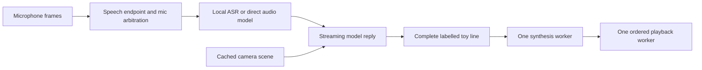

# Sentient latency upgrade

The brain can speak its first complete toy line while the model continues generating. It can synthesize the next line while the first plays. The default `responsive` profile also shortens the wait after speech and skips new camera capture requests during a response.

## What changed

Previously, the brain waited for the whole model reply, then synthesized and played each line in sequence. Now the model streams into a strict line parser and a bounded speech pipeline:



- LiteRT-LM uses its streaming iterator; llama.cpp and GenieX use Server-Sent Events.
- Only complete labelled lines for online toys are queued. Explicit thought blocks and reasoning channels are excluded. A stream failure cannot cause an automatic resend after visible output starts. A token-limit stop discards the incomplete tail on the HTTP backends.
- One synthesis worker keeps Piper calls serial; a separate playback worker preserves speaker order. There are at most two reply lines. Playback errors mark the turn failed and release the response lock.
- Camera requests use cached views during a turn. An existing capture/recognition operation may finish; new capture requests resume after playback. Images older than three seconds are not attached to the model. The small scene description still comes from the perception cache.
- Piper still produces mono 16 kHz signed 16-bit PCM. The existing `PLAY_CODEC` / `PLAY_RATE` settings control the wire format: default 16 kHz mu-law, with PCM and 8 kHz options retained. Each line is encoded and uploaded in full. This is line streaming, not sample-by-sample streaming or interruption support.
- The school-focused characters are preserved. Penny is whimsical and silly while giving careful, accurate answers. Her spelling is never deliberately altered, and other toys can take the next turn normally. The scripted scene follows the same characterization and invites the child to respond at the end.

## Profiles

| Setting | Previous behavior | `responsive` (default) | `patient` |
|---|---:|---:|---:|
| Silence to end an utterance | 700 ms | 500 ms | 700 ms |
| Maximum wait for other microphones | 350 ms | 120 ms | 350 ms |
| Filler before model reply | On | Off | On |
| Stream model and overlap speech work | No | Yes | Yes |

With one online toy, arbitration now returns immediately. With several, it stops once all online microphones report an overlapping utterance, choosing the loudest. The two configured maximum waits shrink by a combined 430 ms in responsive mode; real timing also depends on microphone arrival and voice activity detection. If a child pauses between words and is cut off, use `--latency-profile patient`.

## Run with existing models

From the project folder, using the Python environment containing the project's dependencies and models:

```bash
python -m brain.main --latency-profile responsive
python -m brain.main --latency-profile patient
```

Existing LiteRT and llama.cpp backends keep working. An older LiteRT runtime without streaming still works synchronously and receives only the downstream synthesis/playback overlap benefit. `--cpu` applies to LiteRT; GenieX chooses its processor in the server command.

## VENTUNO Q deployment

Run the brain on the board's Ubuntu processor. The board is not yet running this project, so this upgrade does not claim a measured hardware speedup or an enabled NPU.

Arduino documents [GenieX on the VENTUNO Q](https://docs.arduino.cc/de/tutorials/ventuno-q/geniex/) for local NPU execution. Follow that guide to install the runtime, then use these commands **on the board**:

```bash
geniex pull google/gemma-4-E2B-it-qat-q4_0-gguf --model-hub hf
geniex infer google/gemma-4-E2B-it-qat-q4_0-gguf:Q4_0 --compute npu --max-tokens 32 --think=false --prompt "Reply with exactly: NPU OK"
geniex serve --compute npu
```

Keep the server running in its terminal. It uses loopback port 18181. In another board terminal, from the Sentient folder with the brain's Python environment activated:

```bash
SENTIENT_VISION=never python -m brain.main --backend geniex --latency-profile responsive --selftest
SENTIENT_VISION=never python -m brain.main --backend geniex --latency-profile responsive
```

The recommended initial setting `SENTIENT_VISION=never` omits the raw image from the model prompt while retaining cached face/toy/scene descriptions. Direct VLM image processing can dominate response time on this runtime; add `SENTIENT_VISION=sage` only when testing the reader's image features. Arduino's [GPU/llama.cpp guide](https://docs.arduino.cc/tutorials/ventuno-q/llama-cpp/) describes an alternative runtime.

The new adapter checks `/v1/models`, requires the selected model to be cached, uses native `enable_think=false`, and streams `/v1/chat/completions`. It does not launch another runtime if GenieX is missing. The dashboard reports `server-configured`; confirm NPU use from the server/runtime, rather than inferring it from the selected backend. Protocol details follow [Qualcomm's server guide](https://github.com/qualcomm/GenieX/blob/main/docs/cn/run/cli/local-server.mdx).

Optional settings, set before starting Python:

| Variable | Default | Meaning |
|---|---|---|
| `SENTIENT_GENIEX_URL` | `http://127.0.0.1:18181` | Server origin, without `/v1` |
| `SENTIENT_GENIEX_MODEL` | `google/gemma-4-E2B-it-qat-q4_0-gguf:Q4_0` | Exact id from `/v1/models` |
| `SENTIENT_VISION` | `sage` | `never`, `sage`, or `always` for raw image attachment |
| `SENTIENT_OFFLINE` | `offline/` under the project | Local voices, vision and ASR assets |

### Prerequisites still needed for a first board install

The downloaded project did not have an `offline/` model bundle or a brain environment when this upgrade was prepared. GenieX replaces the language-model runtime, not these other dependencies:

- Python packages: `numpy`, `opencv-python-headless`, `webrtcvad-wheels`, `piper-tts`. Optional MediaPipe adds pet/book detection.
- Piper assets under `offline/piper/`: `en_GB-alba-medium.onnx` and `en_US-libritts_r-medium.onnx`, each with its `.onnx.json` file.
- Face assets under `offline/vision/`: YuNet and SFace models, as listed in `brain/config.py`. Optional object detector/embedder assets enable more perception features.
- For the GenieX/llama.cpp audio path, either `whisper-cli` / `whisper-cpp` on PATH plus `offline/whisper/ggml-base.en.bin`, or `faster-whisper` plus a complete local CTranslate2 base.en directory at `offline/faster-whisper-base.en/`. ASR stays on CPU in this upgrade. LiteRT can continue receiving audio directly.

Use a board-native virtual environment, for example `python3 -m venv .venv-brain`, then activate it and install those Python packages. The existing `tools/fetch_offline.sh` lists asset URLs, but it also builds Mac/Pi/Jetson environments. The existing `tools/setup_brain.sh` changes Wi-Fi/hotspot settings; neither script has been run as part of this upgrade. Use the board's current Python version for wheels. Copy the prepared folder to the board and run `--selftest` before connecting toys.

## Read actual timings

The dashboard at `http://<brain-ip>:8080` includes a latency details panel. Its `/state` endpoint returns `latency_breakdown`, and the same content-free timing record is logged after a turn.

For microphone turns, milestones start at the host's receipt of the last voiced audio frame. This includes endpoint silence and arbitration, but excludes delay before that frame reached the host. Event turns start at turn entry.

| Milestone | What it measures |
|---|---|
| `utterance_ready_ms` | VAD emitted the utterance |
| `turn_started_ms` | Arbitration finished and response started |
| `stt_done_ms` | Separate ASR completed, when used |
| `first_model_text_ms` | First visible model text |
| `first_line_ready_ms` | First complete accepted toy line |
| `first_pcm_ready_ms` | First reply PCM synthesized |
| `first_audio_post_ms` | Brain began the reply's HTTP POST, after acquiring the playback lock |
| `last_playback_ack_ms` | Toy acknowledged the last successful playback request |
| `turn_done_ms` | Playback and cleanup finished |

`first_audio_post_ms` is **not acoustic first-audio latency**: the toy receives the full body before playing, and does not report its first speaker sample. `audio_onset_measured` is explicitly false. The patient profile's filler is excluded from the reply's first audio milestone. `stage_work_ms` separates ASR, model, synthesis, filler wait and upload/playback work; overlapping stages must not be added together.

After deployment, compare repeated identical prompts with the same model, image setting and network. Record at least ten turns, inspect median and slowest turns, and check speech cutoff and reply order with two toys. For actual end-of-speech to speaker onset, measure both sounds with an external recording.

## Local verification

```bash
python tools/test_latency.py
python tools/benchmark_latency.py --runs 5
```

The tests use fake models/voices and loopback-only mock model/toy HTTP servers. They check streaming order, overlap, endpoint timing, parsing, failures, temporary-file cleanup and both HTTP backend contracts. They do not run model inference or claim physical speaker output.

The five-run scheduling simulation used 80 ms to the first model line, another 420 ms to finish the reply, 80 ms synthesis per line, and 200 ms playback per line:

| Simulated median | Previous serial scheduling | New pipeline |
|---|---:|---:|
| Turn entry to first audio POST | 590 ms | 166 ms |
| Total turn | 1,082 ms | 793 ms |

First audio POST fell 71.9% in this controlled simulation. These values demonstrate scheduling overlap; they are not VENTUNO Q performance predictions. Firmware, microphone transport and camera calibration files are outside this change.
