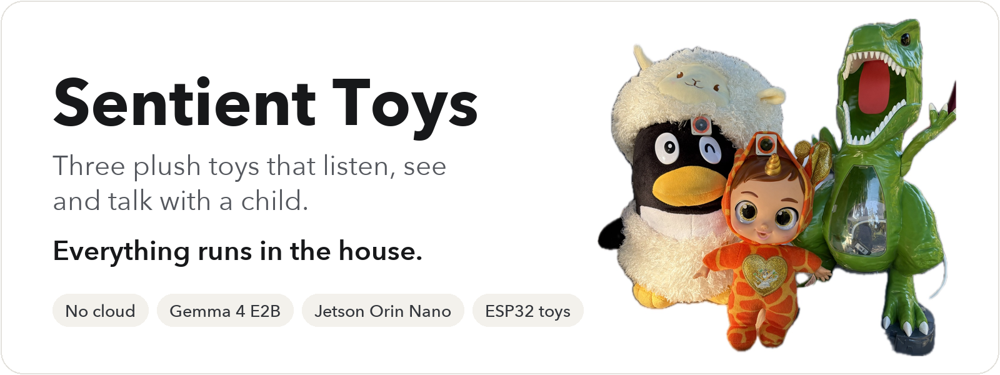
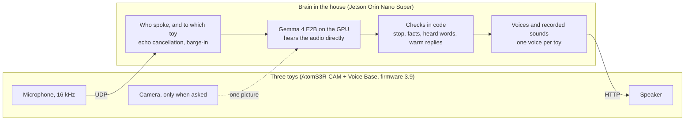
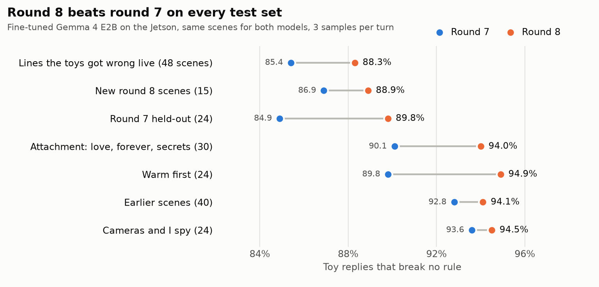

<p align="center">
  
</p>

# Sentient Toys

The things in a child's room come alive and keep them company, like the clock, the teapot and the candlestick in
*Beauty and the Beast*. These ones run on a small computer in the house and never phone home.

**Dyno** is a curious green dinosaur, **Sage** is the reader, and **Penny** is a silly penguin who gives careful, accurate
answers. They listen hands-free, look only when asked, and talk with a child and with each other.

| | |
|---|---|
| **Private** | No cloud anywhere in the loop. Audio is never stored; cameras are off unless the child asks. |
| **Fast** | Under 3 s from the end of a child's sentence to the toy's first word, on a Jetson Orin Nano. |
| **Careful** | A tuned model and checks in code keep the toys from saying "I love you", promising forever or keeping secrets from a parent. Every round is scored. |
| **Open** | Firmware, brain, 1,970 training scenes and every experiment are in this repo. |

Built at the [Google Gemma Hardware Hackathon](https://www.agihouse.org/events/the-google-gemma-hardware-hackathon), AGI House,
Oct 24 2026, and worked on since. [What was built](docs/history.md) · [Every experiment](EXPERIMENTS.md) · [What comes next](docs/next-steps.md)

## How it works



## What the toys do now
- **The child leads.** A toy answers the child before anything else, one toy per answer, and "stop" (or "be quiet", "don't talk to
  me") silences all three. [review loop](docs/review-loop.md)
- **Story mode.** "I'm going to read you a story": the toys stop talking and add one recorded sound after each sentence, about
  0.7 s behind the reader. [story mode](docs/story-mode.md)
- **Cameras only on request.** "What do you see?" and "can we play I spy?" start a look; otherwise no picture is taken.
  [vision](docs/vision.md)
- **Who is talking.** Faces and voices of people a parent enrolled, stored as numbers only inside the encrypted Parent Board.
  [Parent Board](docs/parent-board.md)
- **Checks in code, not in the prompt.** Wrong facts, replies to words nobody said and cold "I am a toy, so I cannot..." openers
  are caught before they are spoken (`brain/factcheck.py`, the heard guard in `brain/director.py`, `brain/warm.py`).
- **Motion sounds and quiet mode.** Toys snore, yell when tossed, and go quiet after a few minutes alone. [IMU sounds](docs/imu-sounds.md)
- **A fine-tuned Gemma, in trial.** Eight LoRA rounds on synthetic scenes; round 8 is the best by the rule scores and is not the
  default model yet. [fine-tune](tools/finetune/README.md) · [plan and results](gemma-kids-social-model-plan.md)

<p align="center"></p>

## Docs
| Topic | Where |
|---|---|
| What was built, in order | [docs/history.md](docs/history.md) |
| What to do next | [docs/next-steps.md](docs/next-steps.md) |
| Every experiment and where its results are | [EXPERIMENTS.md](EXPERIMENTS.md) |
| Jetson setup and services | [docs/jetson.md](docs/jetson.md) · [benchmarks](docs/benchmarks.md) |
| Latency: streaming replies, turn log, tools | [LATENCY.md](LATENCY.md) |
| Echo cancellation and barge-in | [docs/aec.md](docs/aec.md) |
| Cameras, vision model choice, I spy | [docs/vision.md](docs/vision.md) |
| Story mode | [docs/story-mode.md](docs/story-mode.md) |
| Toy-to-toy chat settings and their grades | [docs/gemma-conversation-settings.md](docs/gemma-conversation-settings.md) · [docs/grades/](docs/grades/README.md) |
| Reviewing conversation logs, reply rubric | [docs/review-loop.md](docs/review-loop.md) · [docs/reply-rubric.md](docs/reply-rubric.md) |
| Conversation metrics and coaching | [docs/metrics.md](docs/metrics.md) |
| California academics repository | [docs/curriculum.md](docs/curriculum.md) |
| Parent Board, motion sounds | [docs/parent-board.md](docs/parent-board.md) · [docs/imu-sounds.md](docs/imu-sounds.md) |
| Fine-tuning Gemma for the toys | [tools/finetune/README.md](tools/finetune/README.md) · [plan](gemma-kids-social-model-plan.md) |

## Layout
<details>
<summary>What is in each folder</summary>

| Path | What |
|---|---|
| `firmware/toy-client/` | Arduino sketch for all three Atoms (M5AtomS3R, OPI PSRAM, USB CDC on boot). Copy `secrets.example.h` → `secrets.h`. Update over the air with `tools/ota.py`. |
| `brain/` | `python -m brain.main`: VAD, echo cancellation, perception, director, LLM backends, voices, sounds, dashboard on `:8080`, Parent Board on `:8090`. |
| `tools/` | Test suites (`test_*.py`), benchmarks, latency and echo tools, the toy-chat grader, OTA, setup scripts. |
| `tools/finetune/` | Scene checker, training mixes, LoRA training, merge, scoring; the synthetic scenes are in `data/`. |
| `docs/` | The documents in the table above; `docs/design/` has original design notes, `docs/grades/` the grade ledger (numbers only). |
| `tools/fetch_offline.sh`, `tools/setup_brain.sh` | Download models, voices and aarch64 wheels into `offline/` (not committed); install on the Jetson. |
| `tools/atom_probe.py`, `tools/make_aruco_sheet.py` | Mac-side Atom test; printable toy tags (id 1 Dyno, 2 Sage, 3 Penny). |
| `today-plan-2026-10-24.md`, `atom-agent-latency-plan.md` | Hackathon-day plan; the original latency test plan (done, see `LATENCY.md`). |
| `dyno-sage-penny-deck.pptx` | The 10-slide pitch deck (with speaker notes). Rebuild: `cd deck && npm install && NODE_PATH=$PWD/node_modules PPTX_SKILL=<pptx skill dir> node build_deck.js`. |

</details>

## Run
```bash
bash tools/fetch_offline.sh                 # once, on a fast network
python -m brain.main --selftest             # voices, vision, LLM
python -m brain.main                        # add --cpu on a Pi 5; --backend llamacpp on an Intel Mac
for t in tools/test_*.py; do python $t; done   # 18 test suites, no hardware needed
```
On the Jetson the brain is the `sentient-brain` service; see [docs/jetson.md](docs/jetson.md).

## Hardware notes
<details>
<summary>Six things learned the hard way</summary>

- GC0308 camera has **no JPEG encoder** → capture RGB565, encode in `/capture`.
- esp32-camera takes I2C port 1 with its own pins, which is the ES8311 codec's bus → open port 0 on the
  camera pins (`Wire`) and pass `pin_sccb_sda = -1, sccb_i2c_port = 0`.
- The Echo/Voice Base ES8311 puts ADC data in the I2S slot M5Unified's mono mode doesn't read → set
  `Mic.config().stereo = true` (record() still returns mono).
- `cfg.external_speaker.atomic_echo = true` or the base's mic/speaker stay off.
- `WiFi.macAddress()` is junk before Wi-Fi starts → use `esp_read_mac()`.
- Gemma 4 thinks by default (+8 s/turn) → `ThinkingConfig(enable_thinking=False)`.

</details>

## Privacy
No audio is stored (utterances live in RAM/`/dev/shm` and are deleted after Gemma reads them).
Face, voice and pet embeddings stay on the brain in `brain/data/` (git-ignored), the people's ones encrypted inside the Parent
Board; wipe with `python -m brain.enroll --wipe`. Names and vectors are never logged. Cameras are off unless the child asks.
The fine-tune uses invented scenes only: a real child's words are never uploaded or trained on.
