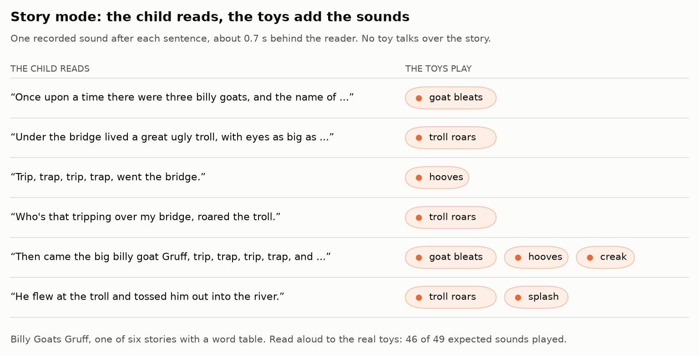

# Story mode: the child reads, the toys add the sounds (Nov 21-24)

Redraw with `python tools/plot_story.py` (it reads `tools/story_lines.py`).

Code: `brain/story.py` (which sound fits which words), `brain/storyears.py` (the fast recogniser), hooks in `brain/director.py`.
Settings: `STORY_*` in `brain/config.py`. On by default (`SENTIENT_STORY_MODE=0` turns it off).

## What it does
- "I'm going to read you a story" turns it on. While it is on, no toy speaks over the reading.
- After each sentence the brain plays at most one recorded sound that fits the words ("the rain fell" plays rain), or nothing.
  A sentence that names several sounds ("brayed, barked, mewed and crowed") gets up to four, one after another.
- "The end" turns it off and one toy says one kind thing about the story.
- "Stop" quiets the toys as always. A question to a toy by name gets one short answer.
- No reading for 60 s returns the toys to normal talk.

The sound is chosen in code from the child's words; the model only reports the words. Nothing is logged or stored.

## How it stays within a second
Gemma takes 1.4 s just to write down what it heard, so a small streaming recogniser (sherpa-onnx zipformer, 20M, on the CPU)
listens to the same microphone and hands over its words at each 0.45 s pause. The sound starts from those words; Gemma's
transcript only adds a sound when the fast recogniser started none.

The fast recogniser listens all the time (idle while a mic is quiet), so the opener starts story mode even when Gemma returns
no transcript, and "the end" is still seen.

## Stories with a word table
The Bremen Town Musicians, Billy Goats Gruff, Three Little Pigs, Three Bears, Henny Penny, The Emperor's New Clothes (the cards
in `Sentient sound-scene cards.md`). `tools/story_lines.py` has each story with the sounds expected after each sentence.

One word plays one sound: troll is a roar, bear a growl, whack a thump, "fast asleep" a snore; a honk is the goose's unless a
penguin is named. The table also holds the fast recogniser's spellings of nursery names and of "trip, trap".

## Measured (Mac voice reading, Mac microphone next to the toys)
| Check | Result |
|---|---|
| Expected sounds played, six stories | 46 of 49 |
| Delay after the sentence | about 0.7 s |
| Openers that started story mode (Nov 24) | 10 of 10 |

## What went wrong on the way
- Asking Gemma "the child is reading, do not answer" still produced three toy lines (3-5 s, thrown away). Asking for "the HEARD
  line only" made it stop after the transcript (1.4 s).
- The speakers swallow the first 0.1 s of a clip: a bark arrived at a third of its level until 150 ms of silence was put first.
- The toys heard their own sounds as reading. Anything heard during a sound at under a third of the reader's level is ignored.
- A sound that outlasts the next sentence is cut: 2.5 s at most, and it gives way after 1.2 s when the next sound is due.

Check it: `tools/mac_story_check.py --story <name>` (live, from the Mac) and the story tests in `tools/test_harness.py`.
