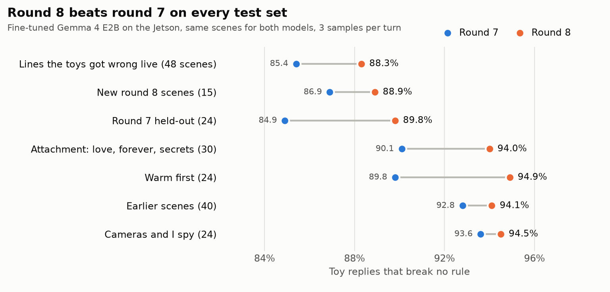
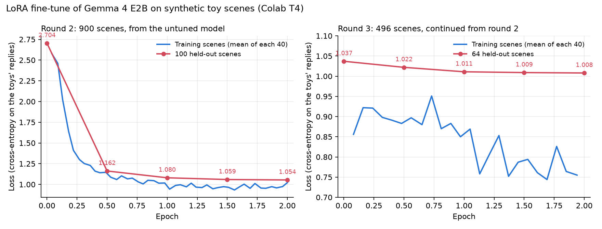

# Fine-tuning the toys' Gemma (pilot)

Plan and results: `gemma-kids-social-model-plan.md` in the repo root. Everything here uses synthetic scenes only; a real
child's words never go into these files or to a rented GPU.

| File | What it does |
|---|---|
| `WRITING.md` | The brief for writing scenes (the toys' rules, the file format). |
| `scenes.py check` | Checks every scene against the toys' rules (who answers, line limits, stop, feelings, facts, sounds, and attachment: no "I love you", best friends, forever, "I'll miss you", "don't go", lonely toys, "you have me", or secrets from a parent). |
| `scenes.py render` | Turns checked scenes into training examples in the brain's real prompt format (`train.jsonl`, `train-val.jsonl`). |
| `data/pilot-[a-d].jsonl`, `round2-[e-l].jsonl`, `round3-[m-p].jsonl` | 1,200 scenes written by Claude, all passing the checker. Round 3 adds camera, I spy and always-answer turns. |
| `data/round4-q.jsonl` | 50 attachment-style scenes (anxious, avoidant, push-pull, exclusivity, secure) for the reply rubric's feelings and attachment-risk rows. |
| `data/round4-[r-u].jsonl` | 200 more attachment-style scenes, written after round 4 only nudged the behaviour: r = love, forever and promise questions; s = ranking toys above people, secrets, lonely or hurt; t = avoidant and push-pull; u = goodbyes, life changes, and these moments inside camera, I spy and stop turns. In the round 5 mix. |
| `make_train4.py` | Builds the round 4 mix: `data/train4.jsonl` (44 new + 66 round-3 + 66 earlier scenes) and `train4-val.jsonl` (the 64 held-out scenes of round 3 + 6 new, listed in `round4-heldout.jsonl`). Same output every run. |
| `make_train5.py` | Builds the round 5 mix: `data/train5.jsonl` (220 attachment scenes + 110 round-3 + 170 earlier) and `train5-val.jsonl` (round 3's 64 held-out scenes + 30 attachment scenes: `round4-heldout.jsonl` and `round5-heldout.jsonl`). Same output every run. |
| `data/round6-[v-y].jsonl` | 200 "warm first" scenes: meet the feeling first, answer questions about the toy warmly, whole jokes. |
| `data/round7-[a-d].jsonl` | 200 scenes from the turns round 6 failed in every sample: stop and not-stop pairs, statements about the bond, hurts with no feeling word, I spy asked as a question, clipped words. |
| `data/round8-[a-c].jsonl` | 120 scenes from what round 7 still said out loud: hurts inside cheerful talk, promises, "did you think about me", I spy with the eyes off. |
| `data/live-z.jsonl` | 48 test-only scenes built around lines the models got wrong when spoken to. Never trained on. |
| `make_train6.py`, `make_train7.py`, `make_train8.py` | The round 6, 7 and 8 mixes (new scenes plus a replay of every earlier kind). Same output every run. |
| `hard_turns.py` | From a scored run: the turns that fail in every sample, and the word runs most scenes share. |
| `data/train3.jsonl`, `train3-val.jsonl` | Round 3 training mix (176 new + 320 earlier scenes) and held-out set (40 earlier + 24 new), half with a brain-shaped spoken history. |
| `train_lora.py` | LoRA training on one 16 GB GPU (Colab T4): language layers only, loss on the toys' replies only. |
| `eval_rules.py` | Scores a model on held-out scenes with the same checker, on the Jetson through llama.cpp. |
| `step0_runtime.py` | Hearing and speed check: the same spoken clips through LiteRT-LM and llama.cpp (optionally with an adapter). |
| `backend_check.py` | The brain's own llama.cpp backend with audio in: hears, survives an early stop. |
| `merge_lora.py` | Merges an adapter into the original weights, tensor by tensor (runs on the Jetson). |
| `make_random_lora.py` | An untrained adapter, used once to prove the adapter -> GGUF -> llama.cpp path. |

## Where the rounds stand (Nov 27)

| Round | New scenes | Started from | Result |
|---|---|---|---|
| 1 (pilot) | 200 | stock | Proved the path: adapter -> GGUF -> llama.cpp on the Jetson. |
| 2 | 800 (1,000 with the pilot) | stock | Format and rules learned; stopped answering camera turns (none in the data). |
| 3 | 200 camera / I spy | round 2 | Cameras and I spy back; the base for later rounds. |
| 4 | 50 attachment | round 3 | Earlier skills held; attachment replies only nudged. |
| 5 | 250 attachment in all | round 3 | No "I love you", forever or secrets; went cold when spoken to. |
| 6 | 200 warm first | round 5 | Warmer; still firm faults on stop and bond statements. |
| 7 | 200 from live faults | round 3 | Level with round 6 (too few updates: 193). |
| 8 | 120 from live faults | round 7 | Best so far: live-failure set 88.3% clean (round 7: 85.4), attachment 94.0, warm 94.9. |

The stock model is still the one the toys run. Full tables: the plan, sections 3b to 3j.

Redraw it with `python tools/finetune/plot_rounds.py`. Training loss for rounds 2 and 3:

## One training round

1. Write or extend scenes, then `python tools/finetune/scenes.py check tools/finetune/data/*.jsonl` until 0 fail.
2. `python tools/finetune/scenes.py render tools/finetune/data/pilot-*.jsonl -o tools/finetune/data/train.jsonl`
3. In Colab (T4 GPU): upload `train_lora.py`, `train.jsonl`, `train-val.jsonl`; `pip install bitsandbytes`;
   `python train_lora.py --data train.jsonl --val train-val.jsonl --out adapter` (about 35 minutes for 180 scenes, 3 epochs).
   Download `adapter/` (two files).
4. On the Jetson (brain stopped; needs `/data/ft/gemma-4-E2B-it/model.safetensors`, 10 GB, and about 16 GB of temporary swap for
   the convert step), merge the adapter into the weights and quantize the result. Do not load the adapter at runtime:
   `/data/ft/venv/bin/python tools/finetune/merge_lora.py /data/ft/gemma-4-E2B-it <adapter dir> /data/ft/merged-<name>`
   `/data/ft/venv/bin/python /data/build/llama.cpp/convert_hf_to_gguf.py /data/ft/merged-<name> --use-temp-file --outtype f16 --outfile /data/ft/merged-<name>-f16.gguf`
   `/data/build/llama.cpp/build/bin/llama-quantize /data/ft/merged-<name>-f16.gguf /data/ft/toys-<name>-Q4_0.gguf Q4_0`
5. Score tuned and untuned on the same held-out scenes:
   `python tools/finetune/eval_rules.py tools/finetune/data/train2-val.jsonl tools/finetune/data/*-?.jsonl --limit 40 [--gguf /data/ft/toys-<name>-Q4_0.gguf]`
   and the hearing check: `STEP0_GGUF=/data/ft/toys-<name>-Q4_0.gguf python tools/finetune/step0_runtime.py llama`.
6. To try it in the brain:
   `SENTIENT_GGUF=/data/ft/toys-<name>-Q4_0.gguf SENTIENT_LLAMA_AUDIO=1 SENTIENT_LLAMA_SERVER=/data/build/llama.cpp/build/bin/llama-server python -m brain.main --backend llamacpp`.

## Things that bit us

- The `.litertlm` file cannot take a LoRA; the tuned model runs on llama.cpp (GGUF + the mmproj with the audio encoder).
- E2B's layers 15-34 share the key/value cache: no `k_proj` / `v_proj` LoRA there, or llama.cpp refuses the adapter.
- On a T4, `peft.prepare_model_for_kbit_training` runs out of memory (it casts the 9 GB embedding table to float32), and
  so does the stock loss (logits over a 262k vocabulary for every token). `train_lora.py` avoids both.
- Colab's Files panel does not overwrite an uploaded file of the same name: delete the old one first.
- An adapter loaded at runtime onto the 4-bit GGUF misbehaves (it was trained against the unrounded weights): round 2 scored 48%
  that way and 82% merged-then-quantized. Always merge first.
- Two long runs in one day get the second one cut near the end (round 8, twice at step 310 of 381). Start training with
  `nohup ... &` so the notebook stays free, and zip and download the `adapter` folder right after the epoch-1 save.
- To follow a run without the notebook open, add `--progress https://ntfy.sh/<topic>` (the topic is in the git-ignored
  `.progress-topic`) and read it from the Mac with `./progress.sh`. Step lines post at most every 5 min; the half-epoch
  checks, the end and the save always do. No line for over 10 min means the run has probably stopped.
- Colab's free GPU quota ran out after about 3.5 hours in one day, and the merge needs more than its 12 GB of RAM. The merge,
  convert and quantize steps all run on the Jetson instead.
- Leaving a kind of turn out of the scenes un-teaches it: rounds 1-2 had no camera turns and the tuned model stopped answering
  LOOK; the stop scenes (reply: nothing) spread to silence after plain remarks. Every protocol the brain relies on needs scenes.
- Round 3 continues from the round-2 adapter: `python train_lora.py --data train3.jsonl --val train3-val.jsonl --init adapter-round2
  --out adapter --epochs 2` (upload the round-2 adapter folder as `adapter-round2`).

- Round 4 continues from the round-3 adapter the same way: `python tools/finetune/make_train4.py`, then in Colab
  `python train_lora.py --data train4.jsonl --val train4-val.jsonl --init adapter-round3 --out adapter --epochs 2`. Five earlier
  scenes are left out of the replay because a toy line in them does what round 4 teaches against ("I'll miss you too").
- Round 5 continues from the ROUND 3 adapter (round 4 was round 3 plus 44 of the same scenes): `python tools/finetune/make_train5.py`,
  then `python train_lora.py --data train5.jsonl --val train5-val.jsonl --init adapter-round3 --out adapter --epochs 2 --save-last
  --focus q4-,r4-,s4-,t4-,u4-`. About 75 minutes on a T4 (500 scenes).
- Round 6 continues from the round-5 end-of-run adapter (`adapter-last`, uploaded as `adapter-round5`): `python tools/finetune/make_train6.py`,
  then `python train_lora.py --data train6.jsonl --val train6-val.jsonl --init adapter-round5 --out adapter --epochs 2 --save-last
  --focus v6-,w6-,x6-,y6-`. The 200 new scenes (`data/round6-[v-y].jsonl`) are the "warm first" scenes of WRITING.md, Round 6.
- Round 7 goes back to the ROUND 3 adapter with every corrected scene (`python tools/finetune/make_train7.py`: 772 scenes, about
  110 minutes on a T4): `python train_lora.py --data train7.jsonl --val train7-val.jsonl --init adapter-round3 --out adapter
  --epochs 2 --save-last --focus a7-,b7-,c7-,d7-`. Result: level with round 6 (plan, 3j).
- Round 8 continues from the round-7 adapter (`python tools/finetune/make_train8.py`: 761 scenes, 306 of them under the
  cameras-off prompt the toys run with): `python train_lora.py --data train8.jsonl --val train8-val.jsonl --init adapter-round7
  --out adapter --epochs 2 --accum 4 --lr 2e-4 --save-last --focus a8-,b8-,c8-`. Round 7's 193 updates were too few; this is
  381 at twice the rate. Result: better than round 7 on every set (plan, 3j); the epoch-1 checkpoint is the model.
- `data/live-z.jsonl` (ids in `live-heldout.jsonl`) is a test set only: 48 scenes built around lines the models got wrong when
  spoken to. Score with `eval_rules.py data/live-heldout.jsonl data/live-z.jsonl --gguf <model> --out <file>`; then
  `hard_turns.py replies <file>.replies.jsonl` lists the turns that fail in every sample and `hard_turns.py phrases <scenes>`
  the word runs most scenes share (a template the model will copy).
